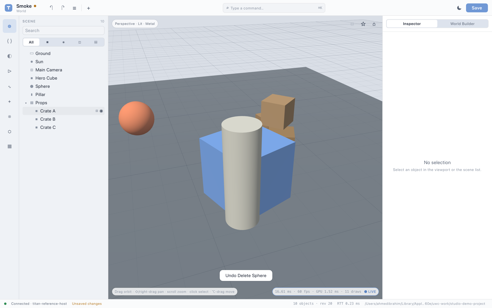
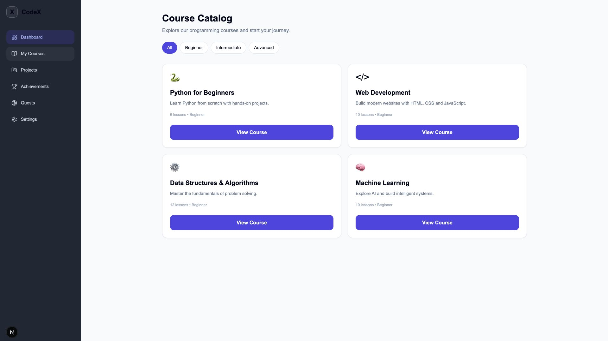

# TITAN Ecosystem

**An interconnected approach to learning, writing, and building software.**

TITAN brings learning, editing software and building interactive scenes into a shared project direction.

The ecosystem brings together three team-developed projects. Integration through shared workflows remains a future goal.

[Watch Studio](Media/Videos/titan-studio-demo.mp4) · [Browse screenshots](Media/Screenshots/)

## TITAN Code

A Rust editor core and engineering backend. Its interface is a versioned JSON-RPC protocol consumed by diagnostic tools and future frontends.

- **Text and documents:** Unicode-aware coordinates, revision-checked edits, transactions, undo/redo, encoding and line-ending handling.
- **Workspaces:** safe paths, file discovery, buffer and disk search, filesystem watching and background indexing.
- **Language tooling:** tree-sitter syntax analysis, a rust-analyzer client, and a project graph that records relationships and provenance.
- **Reliable changes:** recovery journals, conflict detection, multi-file change proposals, explicit approval, rollback and verification in isolated worktrees.
- **Performance work:** bounded worker pools, resource-aware graph updates and a benchmark harness for editing under load.

The architecture separates the in-memory text engine from document persistence, workspace services and the server. See the [source](TITAN-Code/) and [protocol](TITAN-Code/docs/protocol.md).

```bash
cd TITAN-Code
cargo test --workspace
cargo run -p titan-server --bin titan-probe -- --report probe-report.json
```

The included [probe transcript](docs/engineering/code-probe.log) walks through editing, undo/redo, saving, search, indexing and crash recovery against the real service.

## TITAN Studio

A native Qt/QML editor with a Metal viewport. A separate engine-host process owns the project and scene; the editor sends commands over a versioned local protocol.



Studio provides a scene hierarchy, viewport navigation and picking, transform editing, undo/redo, hierarchy operations, copy/paste, camera bookmarks, an asset workspace and project persistence. World Builder previews procedural changes before applying them.

The captures use the TITAN reference backend. The source also contains an Unreal bridge adapter, with its own capability contract. The core includes modules for assets, simulation, navigation and behavior logic.

```bash
cmake -S TITAN-Studio -B build -G Ninja
cmake --build build -j 2
ctest --test-dir build -LE unreal --output-on-failure
```

Qt 6.7 or newer is required. See the original [build instructions](TITAN-Studio/docs/BUILD_INSTRUCTIONS.md) and [architecture](TITAN-Studio/docs/ARCHITECTURE.md).

## Codex

A Next.js and React learning frontend built around a dashboard, course catalog and lesson interface. The Python lesson uses answer selection and immediate feedback to introduce variables.



The dashboard and catalog use sample content. Lesson interaction runs in the browser. Connecting Codex exercises to TITAN Code workspaces and Studio projects is a future goal.

The preserved source contains local and ZIP-derived variants. The [local-source frontend](Codex/current/مصادر%20العمل%20المحلية/codex-frontend/) is the version shown here.

## Development

This is a collaborative project spanning Rust for Code, C++/QML for Studio and TypeScript/React for Codex. Original source provenance and AI-assistance attribution are retained in SOURCES.md.

The engineering questions are concrete: how to preserve unsaved work after a crash, keep edits consistent across processes, update language information without slowing typing, and make a lesson respond clearly to a student's input.

[Development notes](docs/DEVELOPMENT.md) describe these decisions. [Test notes](docs/engineering/TESTING.md) retain the commands and results, including environment-dependent tests. [SOURCES.md](SOURCES.md) records source commits, attribution and licenses.

## Repository layout

- `TITAN-Code/` — Rust backend source
- `TITAN-Studio/` — desktop editor and engine-host source
- `Codex/` — educational frontend source variants
- `Media/` — original screenshots and demonstrations
- `docs/engineering/` — test logs, source manifests and technical records

The three source trees retain their original structure and contents. This public source release has independent Git history. Source notices and third-party terms remain in place; publication does not grant a new open-source license. See [release review](PUBLIC_RELEASE.md).
